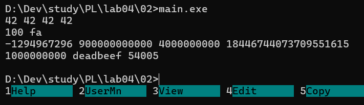
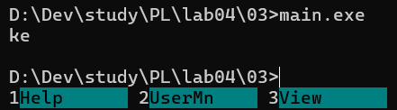
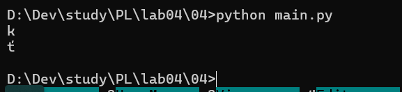
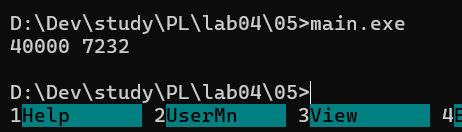
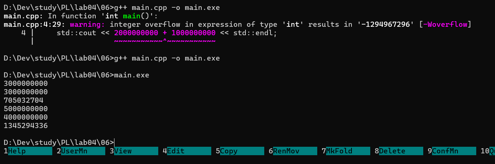
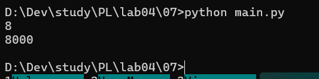
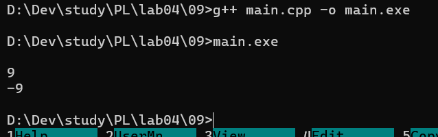

# Языки программирования

## Лабораторная работа 3

### Задание 1

**Двоичное представелние числа -99**

- _1 байт: 10011101_
- _2 байта: 11111111 10011101_
- _4 байта: 11111111 11111111 11111111 10011101_

**Шестнадцатеричные литералы**

- _Наибольшее 2 147 483 647 = 0x7FFFFFFF_
- _Наименьшее -2 147 483 648 = 0x80000000_

**Двоичное представление _#_ в _char_**

_00100011_

### Задание 2



### Задание 3


_Запустив программу, я получил вывод ke._
_Первый символ - 'k', так как в таблице ASCII её код (107) ровно на 10 больше кода буквы 'a' (97)._
_Второй символ - 'e'. При добавлении 250 происходит переполнение 8-битного типа char. Итоговый код находится как остаток от деления на 2^8 и это дает 101, что соответствует букве 'e'._
_В итоге значение переменной a меняется по цепочке:_
_97_
_97 + 10 = 107_
_107 + 250 = 357_
_357 % 256 = 101_

### Задание 4



_Вывод отличается от C++, так как Python работает с кодировкой Unicode, а не ASCII._
_Первый вывод: Совпадает с C++, логика смещения одинакова (97 + 10 = 107)._
_Второй вывод: Переполнения байта не происходит. Python поддерживает символы за пределами ASCII, поэтому корректно выводит символ Unicode с кодом 357._

_В итоге перменная а меняет свой код так_

- 97
- 97 + 10 = 107
- 107 + 250 = 357

### Задание 5.



_Переменная y_

- _40 000 + 40 000 = 80 000_
- _y = 80 000 mod 65 536 = 14 464_
- _14 464 - 40 000 = -25 536_
- _y = -25 536 + 65 536 = 40 000_\
  _После всех преобразований число вернулось в исходный вид_

_Переменная z_

- _40 000 _ 2 = 80 000\*
- _z = 80 000 mod 65 536 = 14 464_
- _z = 14 464 / 2 = 7 232_\
  _В конце преобразоваий не призошло, поэтому число не вернулось в исходный вид_

### Задание 6

```
std::cout << 2000000000 + 1000000000 << std::endl;
```

_Два числа являются int, происходит знаковое переполнение, поэтому вывод -1 294 967 296_

- _2 000 000 000 + 1 000 000 000 = 3 000 000 000_
- _3 000 000 000 - 4 294 967 296 = -1 294 967 296_

```
std::cout << 2000000000U + 1000000000U << std::endl;
```

_Два числа являются unsigned int, здесь места хватает для обычного сложения, так что вывод 3 000 000 000_

```
std::cout << 2500000000U + 2500000000U << std::endl;
```

_Два числа являются unsigned int, происходит беззнаковое переполнение, вывод будет 705 032 704_

- _2 500 000 000 + 2 500 000 000 = 5 000 000 000_
- _5 000 000 000 mod 4 294 967 296 = 705 032 704_

```
std::cout << 2500000000LL + 2500000000LL << std::endl;
```

_Два числа являются long long int, места хватает, вывод 5 000 000 000_

```
std::cout << 20000U * 200000U << std::endl;
```

_Два числа являются unsigned int, места хватает, вывод 4 000 000 000_

```
std::cout << 200000U * 200000U << std::endl;
```

_Два числа являются unsigned int, происходит беззнаковое переполнение, вывод будет 1 345 294 336_

- _2 000 000 000 _ 2 000 000 000 = 40 000 000 000\*
- _40 000 000 000 mod 4 294 967 296 = 1 345 294 336_

_Вот вывод программы с этими элементами кода_\


### Задание 7

```
x = int(input())
y = (x << 2) + x
y = (y << 2) + y
y = (y << 2) + y
y = (y << 3)
print (y)
```



### Задание 8

**`(1000 & 100) << 10`**

- _1000 = 0000 0000 0000 0000 0000 0011 1110 1000_
- _100 = 0000 0000 0000 0000 0000 0000 0110 0100_
- _& = 0000 0000 0000 0000 0000 0000 0110 0000_
- _<<10 = 0000 0000 0000 0001 1000 0000 0000 0000_
- _Ответ: 98304_

**`(1000 >> 4) & 15`**

- _1000 = 0000 0000 0000 0000 0000 0011 1110 1000_
- _>>4 = 0000 0000 0000 0000 0000 0000 0011 1110_
- _15 = 0000 0000 0000 0000 0000 0000 0000 1111_
- _& = 0000 0000 0000 0000 0000 0000 0000 1110_
- _Ответ: 14_

**`~1234 + 1234`**

- _1234 = 0000 0000 0000 0000 0000 0100 1101 0010_
- _~1234 = 1111 1111 1111 1111 1111 1011 0010 1101_
- _+ = 1111 1111 1111 1111 1111 1111 1111 1111_
- _Ответ: -1_

**`(1000 ^ 500) & 63`**

- _1000 = 0000 0000 0000 0000 0000 0011 1110 1000_
- _500 = 0000 0000 0000 0000 0000 0001 1111 0100_
- _^ = 0000 0000 0000 0000 0000 0010 0001 1100_
- _63 = 0000 0000 0000 0000 0000 0000 0011 1111_
- _& = 0000 0000 0000 0000 0000 0000 0001 1100_
- _Ответ: 28_

**`(100 << 3) + (100 >> 3)`**

- _100 = 0000 0000 0000 0000 0000 0000 0110 0100_
- _<<3 = 0000 0000 0000 0000 0000 0011 0010 0000_
- _100 = 0000 0000 0000 0000 0000 0000 0110 0100_
- _>>3 = 0000 0000 0000 0000 0000 0000 0000 1100_
- _+ = 0000 0000 0000 0000 0000 0011 0010 1100_
- - _Ответ: 812_

### Задание 9

```
#include <iostream>

int main() {
    int number = 0;
    std::cin >> number;
    int result = ~number + 1;
    std::cout << result << std::endl;
    return 0;
}
```


