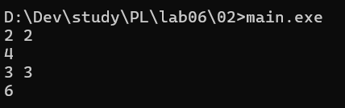
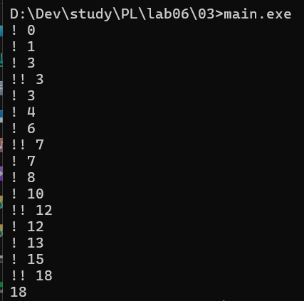
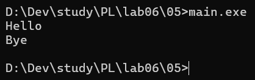
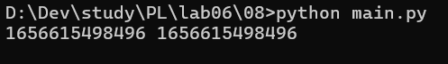
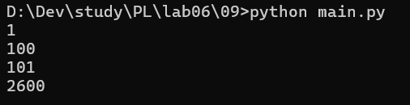

# Языки программирования

## Лабораторная работа 6

### Задание 1 **(3)**

_Рассмотрим следующую программу на С++._

```
#include <iostream>
#include <cmath>
int main() {
   double x = 0;
   const auto Pi = std::acos(0) * 2;
   std::cout << Pi << std::endl;
   return 0;
}
```

_Проверьте четыре способа объявления_ **Pi**.

- `const auto Pi = acos(0) * 2;`
- `constexpr auto Pi = std::acos(0) * 2;`
- `const auto Pi = acos(x) * 2;`
- `constexpr auto Pi = std::acos(x) * 2;`

_Что можно сказать об этих вариантах? Проверьте, в каких вариантах объявляется константа этапа трасляции._

_Тексты программ разместите в папке с номером задания_

### Задание 2 **(2)**

_Проверьте работу следующей программы на С++_

```
#include <iostream>
int main() {
   {
      int x, y;
      std::cin >> x >> y;
      std::cout << x+y << std::endl;
   }
   {
      double x, y;
      std::cin >> x >> y;
      std::cout << x+y << std::endl;
   }
   return 0;
}
```

В программе нужны вложенные фигурные скобки, т. к. переменные x и y здесь объявляются два раза, и поэтому для избежания конфликта необходимо использовать разные пространства имён.



### Задание 3 **(2)**

```
int s = 0;
for (int i = 0; i < 4; i++) {
   for (int i = 0; i < 3; i++) {
      s += i;
   }
   s += i;
}
std::cout << s;
```

Итоговое значение 18 сформировалось за счёт суммирования во всех итерациях. Поскольку переменная s объявлена на уровне функции, её значение накапливалось непрерывно и сохранилось вплоть до финального вывода на экран.



### Задание 4 **(2)**

```
s = 0
for i in range(4):
   for i in range(3):
      s += i
   s += i
print(s)
```

Ответ 20 выходит потому, что циклы в Python разделяют одну область видимости, а не создают новые, как в C++. Из-за постоянного перезаписывания переменной i внутренним циклом, внешняя команда s += i всегда суммирует её последнее значение - 2.

### Задание 5 **(2)**

Программа выводит на экран приветствие и прощание, вызывая одноименные по смыслу функции из двух разных пространств имен.


### Задание 6 **(2)**

_Рассмотрим следующий фрагмент программы. Эта программа 1000000 раз обменивает значения двух длинных
строк с использованием третьей строки. Проверьте, насколько быстро она работает._

```
std::string a(100000, 'a');
std::string b(100000, 'b');
for (int i=0;i<1000000;i++) {
   std::string c(a);
   a = b;
   b = c;
}
std::cout << a[0] << b[0];
```

_Попробуйте использовать для обмена значений строк функцию_ **swap**.
_Проверьте, изменилось ли время работы. В чем ошибка исходной программы?
Исправьте исходную программу, чтобы ускорить ее работу. Изменения не должны
затрагивать общий вид программы (присваивания, использование временной переменной)._

### Задание 7 **(2)**

```
a = 'Hello world'
print(a, id(a))
b = a
print(b, id(b))
a += ' and goodbye'
print(a, id(a))
print(b, id(b))
```

Программа выводит строки и их адреса памяти (id). Первый объект создаётся на строке 1, а на строке 3 переменная b просто копирует ссылку на него, из-за чего их id совпадают. На строке 5 из-за неизменяемости строк в Python старый объект не меняется - вместо этого создаётся второй, новый строковый объект, и a перенаправляется на него, получая другой id. Функция id возвращает уникальный идентификатор (адрес) объекта, на который указывает переменная.

### Задание 8 **(2)**


Для строк принципиальной практической разницы между b = a и b = a[:] нет. Переменные делят один и тот же адрес в памяти.

### Задание 9 **(3)**



Программа создаёт в цикле 2600 переменных используя с помощью функции globals(), затем записывает в эту перменную значение переменной value и увеличивает value на 1. На изображении вывод нескольких переменных.
